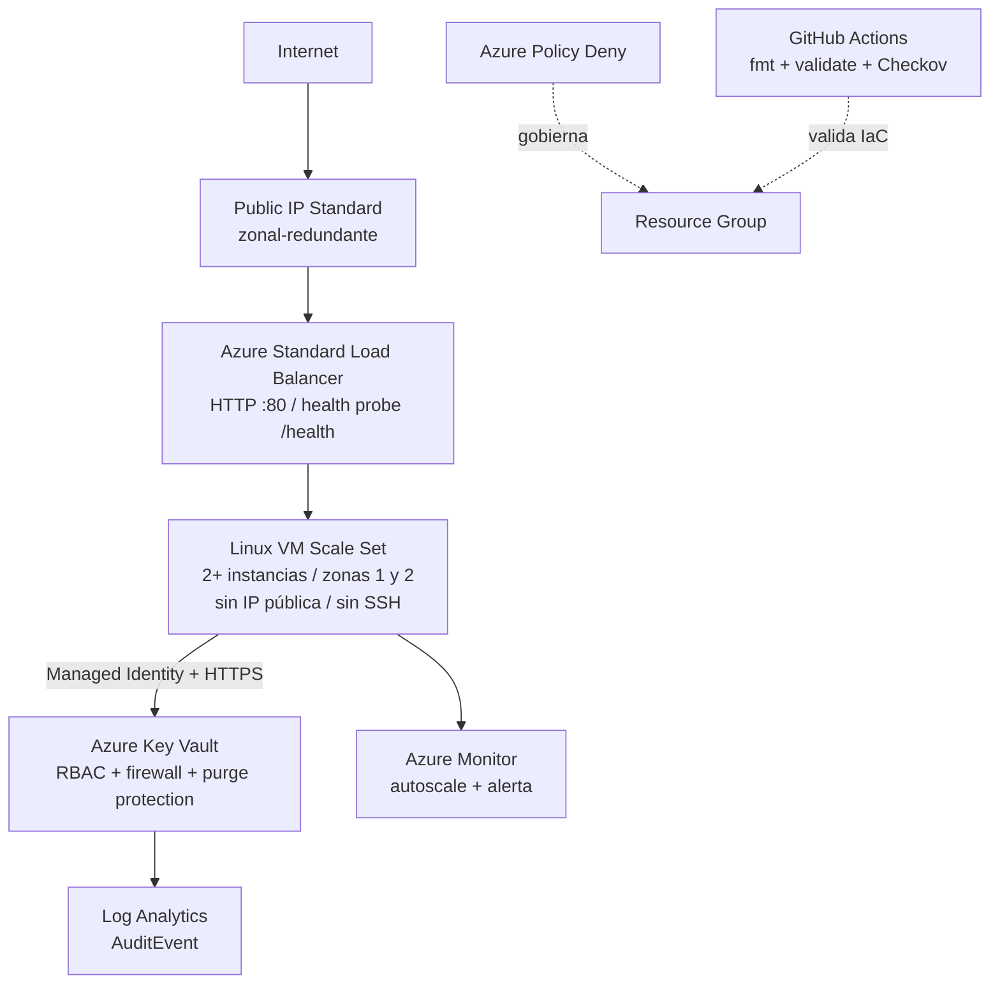

# CaribeShop — Taller integrador resuelto

Solución base para el caso **CaribeShop**: plataforma segura, escalable y altamente disponible en Azure, desplegada con Terraform y validada con GitHub Actions, Checkov y Locust.

> Importante: el repositorio deja listo el código, los comandos y las plantillas de evidencia. Las métricas de carga, tiempos de recuperación, correos de alerta, capturas de Policy y resultados de Azure deben obtenerse al ejecutar el laboratorio; no se deben inventar.

## Arquitectura



### Controles implementados

- **S1:** Terraform completo; backend remoto separado en Azure Storage; `.gitignore`; sin credenciales en el código.
- **S2:** VNet + subnet de aplicación; NSG restrictivo; VMSS sin IP pública; sin reglas 22/3389; egress restringido.
- **S3:** Key Vault con RBAC, purge protection, firewall, expiración del secreto y lectura desde la app mediante Managed Identity.
- **S4:** identidad del VMSS con rol `Key Vault Secrets User` únicamente sobre el Key Vault.
- **S5:** Azure Policy personalizada con efecto `Deny` para impedir Storage Accounts sin HTTPS obligatorio.
- **S6:** `AuditEvent` de Key Vault enviado a Log Analytics.
- **E1:** VMSS en zonas 1 y 2, mínimo 2 instancias.
- **E2:** Standard Load Balancer con sonda HTTP `/health`.
- **E3:** autoscale CPU > 70 % y < 30 %, ventanas/cooldowns diferentes e `ignore_changes = [instances]`.
- **E4:** reparación automática de instancia (`Replace`).
- **E5:** alerta de Azure Monitor por CPU sostenida con correo.
- **D1:** workflow de PR con `terraform fmt -check`, `validate` y Checkov bloqueante.
- **D2:** cada `#checkov:skip` del proyecto está justificado en `report/RIESGOS.md`.
- **D3:** la VM se configura sola con cloud-init; no hay pasos manuales en el sistema operativo.

## Ejecución rápida (scripts)

Todo el flujo está automatizado; la guía paso a paso está en [`PLAN_ENTREGA.md`](PLAN_ENTREGA.md).

```bash
bash scripts/00-instalar-herramientas.sh          # az, terraform, gh, locust (Ubuntu/WSL o Mac)
az login
ALERT_EMAIL=correo@utb.edu.co bash scripts/01-desplegar.sh   # backend remoto + plataforma
bash scripts/pruebas/10-evidencias-base.sh         # S1–S6, E1–E3, E5, D3
bash scripts/pruebas/20-p1-capacidad.sh            # P1.1
bash scripts/pruebas/30-p1-escalonado.sh           # P1.2/P1.3
bash scripts/pruebas/40-p2-falla-logica.sh         # P2.1 + E4
bash scripts/pruebas/50-p2-falla-abrupta.sh        # P2.2
bash scripts/pruebas/60-p3-seguridad.sh            # P3
python3 scripts/analizar_resultados.py             # gráficos + resumen numérico
bash scripts/99-destruir.sh                        # terraform destroy
```

## Checklist de la línea base de seguridad

- [x] Toda la infraestructura en Terraform; estado en backend remoto `azurerm` (Entra ID, sin Shared Key, firewall)
- [x] `.gitignore` excluye `*.tfstate`, `*.tfplan`, `*.tfvars` reales; `scripts/repo-safety-check.sh` revisa el historial
- [x] Sin credenciales en el código: el secreto lo genera Terraform y vive en Key Vault
- [x] VNet + subred de aplicación + NSG de mínimo privilegio (solo HTTP 80 desde Internet y sonda del LB)
- [x] Ninguna VM con IP pública; puertos 22/3389 sin reglas Allow
- [x] Egress restringido: solo `AzureKeyVault:443`; Internet y tráfico lateral denegados
- [x] Managed Identity del VMSS con rol único `Key Vault Secrets User` sobre el Key Vault
- [x] Key Vault con RBAC, purge protection, firewall (subred + IP del operador) y secreto con expiración (90 días)
- [x] La app nunca muestra el secreto: solo longitud y SHA-256 truncado
- [x] Azure Policy con efecto `Deny` asignada por Terraform al grupo de recursos
- [x] Diagnostic settings del Key Vault (`AuditEvent`) hacia Log Analytics
- [x] Alerta de Azure Monitor con notificación por correo
- [x] Pipeline en cada PR: `terraform fmt -check`, `validate` y Checkov bloqueante
- [x] Cada `#checkov:skip` justificado en `report/RIESGOS.md`
- [x] VM configurada sola por cloud-init (sin pasos manuales)

## Variables requeridas

| Variable | Dónde | Descripción |
|---|---|---|
| `operator_ip` | `bootstrap/`, `infra/` | IPv4 pública de quien ejecuta Terraform (sin `/32`) |
| `alert_email` | `infra/` | Correo que recibe la alerta |
| `ssh_public_key` | `infra/` | Llave pública (exigida por la VM Linux; el puerto 22 no se abre) |
| `location`, `vm_sku`, `zones` | ambos | Por defecto `belgiumcentral`, `Standard_D2as_v4`, zonas 1 y 2 |
| `min_instances`, `max_instances` | `infra/` | 2 y 4 |

`scripts/01-desplegar.sh` genera los `terraform.tfvars` automáticamente; también se pueden copiar desde los `.example`.

## 1. Prerrequisitos

- Cuenta/suscripción de Azure con permisos para crear Resource Groups, redes, VMSS, roles, Policy, Key Vault y Monitor.
- Azure CLI autenticada: `az login`.
- Terraform reciente compatible con AzureRM 5.x.
- Una llave SSH pública. Solo se usa para satisfacer el requisito del sistema operativo; **no se abre SSH en el NSG**.
- IP pública actual del integrante que ejecuta Terraform, en formato IPv4 sin `/32`.
- Correo donde se recibirá la alerta.

Compruebe cuota antes de desplegar:

```bash
az vm list-usage -l belgiumcentral -o table
```

## 2. Crear el backend remoto de Terraform

El backend se crea una sola vez con el módulo `bootstrap/`. El estado inicial del bootstrap es local; luego se migra al contenedor remoto.

```bash
cd bootstrap
cp terraform.tfvars.example terraform.tfvars
# Edite operator_ip, prefix y location.
terraform init
terraform fmt -check
terraform validate
terraform plan -out bootstrap.tfplan
terraform apply bootstrap.tfplan
terraform output
```

Copie los valores de `backend_config_example`, habilite el backend y migre el propio estado del bootstrap:

```bash
cp backend.tf.example backend.tf
terraform init -migrate-state \
  -backend-config="resource_group_name=<RG_ESTADO>" \
  -backend-config="storage_account_name=<STORAGE>" \
  -backend-config="container_name=tfstate" \
  -backend-config="key=bootstrap.tfstate" \
  -backend-config="use_azuread_auth=true" \
  -backend-config="use_cli=true"
```

> El Storage Account del estado usa Microsoft Entra ID, Shared Key deshabilitada, HTTPS/TLS 1.2, ZRS, versionado y firewall que solo permite la IP del operador.

## 3. Desplegar la plataforma

```bash
cd ../infra
cp terraform.tfvars.example terraform.tfvars
# Edite operator_ip, alert_email y ssh_public_key.

terraform init \
  -backend-config="resource_group_name=<RG_ESTADO>" \
  -backend-config="storage_account_name=<STORAGE>" \
  -backend-config="container_name=tfstate" \
  -backend-config="key=caribeshop-prod.tfstate" \
  -backend-config="use_azuread_auth=true" \
  -backend-config="use_cli=true"

terraform fmt -check
terraform validate
terraform plan -out caribeshop.tfplan
terraform apply caribeshop.tfplan
```

Obtenga la URL:

```bash
terraform output -raw app_url
curl "$(terraform output -raw app_url)/health"
curl "$(terraform output -raw app_url)/secret-check"
```

La respuesta de `/secret-check` muestra únicamente longitud y SHA-256 truncado del secreto; **nunca el valor**.

## 4. Evidencias principales

### S2 — ninguna instancia tiene IP pública

```bash
RG=$(terraform output -raw resource_group_name)
VMSS=$(terraform output -raw vmss_name)
az vmss list-instance-public-ips -g "$RG" -n "$VMSS" -o table
```

El resultado debe quedar vacío.

### S4 — rol mínimo de la Managed Identity

```bash
PRINCIPAL=$(terraform output -raw vmss_principal_id)
az role assignment list --assignee "$PRINCIPAL" -o table
```

Debe verse `Key Vault Secrets User` sobre el Key Vault, sin roles de escritura.

### S5 — demostrar Azure Policy Deny

Espere unos minutos después del `apply` para la propagación de Policy y ejecute:

```bash
RG=$(terraform output -raw resource_group_name)
LOC=$(terraform output -raw location)
BAD="badhttp$(date +%s | tail -c 9)"
az storage account create \
  -g "$RG" -n "$BAD" -l "$LOC" \
  --sku Standard_LRS --https-only false
```

La creación debe ser rechazada por Policy (efecto `Deny`). Guarde la salida completa donde aparezca el rechazo.

### S6 — KQL de lectura del secreto

Primero invoque varias veces:

```bash
for i in {1..5}; do curl -s "$(terraform output -raw app_url)/secret-check"; echo; sleep 2; done
```

Luego ejecute en Log Analytics:

```kusto
AzureDiagnostics
| where ResourceProvider == "MICROSOFT.KEYVAULT"
| where OperationName has "SecretGet"
| project TimeGenerated, OperationName, identity_claim_oid_g, CallerIPAddress, ResultType
| order by TimeGenerated desc
```

Compare `identity_claim_oid_g` con `terraform output -raw vmss_principal_id`.

## 5. P1 — carga y escalamiento

### P1.1 Capacidad de una instancia

1. Deshabilite temporalmente autoscale y reduzca el VMSS a una instancia:

```bash
RG=$(terraform output -raw resource_group_name)
VMSS=$(terraform output -raw vmss_name)
AUTOSCALE=$(terraform output -raw autoscale_name)
az monitor autoscale update -g "$RG" -n "$AUTOSCALE" --enabled false
az vmss scale -g "$RG" -n "$VMSS" --new-capacity 1
```

2. Corra Locust incrementando usuarios hasta que p95 supere 1 s. Ejemplo:

```bash
cd ../loadtest
TARGET_URL=$(cd ../infra && terraform output -raw app_url)
locust -f locustfile.py --host "$TARGET_URL" --headless \
  -u 25 -r 5 -t 5m --csv results/capacity_25 --html results/capacity_25.html
```

Repita con más usuarios y registre el **RPS máximo sostenible antes de que p95 supere 1 s**.

3. Restaure el mínimo de dos instancias y autoscale:

```bash
az vmss scale -g "$RG" -n "$VMSS" --new-capacity 2
az monitor autoscale update -g "$RG" -n "$AUTOSCALE" --enabled true
```

### P1.2 Perfil escalonado de 25 minutos

```bash
mkdir -p results
LOCUST_USE_SHAPE=1 LOCUST_PEAK_USERS=180 locust -f locustfile.py --host "$TARGET_URL" --headless \
  --csv results/step25 --html results/step25.html
```

El `LoadTestShape` del archivo realiza subida, carga sostenida y bajada (25 min) más una cola de 10 min de carga baja para observar el scale-in. Alinee en el informe:

- número de instancias en el tiempo;
- RPS;
- p95;
- eventos de scale-out y scale-in.

## 6. P2 — pruebas de falla

### Falla lógica

Obtenga los ID de instancia:

```bash
az vmss list-instances -g "$RG" -n "$VMSS" --query "[].instanceId" -o tsv
```

Marque una instancia como no saludable sin abrir SSH:

```bash
INSTANCE_ID=<ID>
az vmss run-command invoke -g "$RG" -n "$VMSS" --instance-id "$INSTANCE_ID" \
  --command-id RunShellScript \
  --scripts "touch /tmp/caribeshop-unhealthy"
```

`/health` empezará a responder 503 en esa instancia. Durante carga moderada mida:

- instante `T0` cuando se crea el marcador;
- instante `T1` cuando deja de recibir tráfico;
- `T1-T0`;
- peticiones fallidas;
- `% error = fallidas / totales × 100`.

Para devolverla a sana:

```bash
az vmss run-command invoke -g "$RG" -n "$VMSS" --instance-id "$INSTANCE_ID" \
  --command-id RunShellScript \
  --scripts "rm -f /tmp/caribeshop-unhealthy"
```

> La reparación automática tiene un `grace_period` de 10 minutos y acción `Replace`; por eso una instancia que permanezca no saludable puede terminar reemplazada.

### Falla abrupta

Durante carga moderada:

```bash
INSTANCE_ID=<ID>
az vmss delete-instances -g "$RG" -n "$VMSS" --instance-ids "$INSTANCE_ID"
```

Mida errores y tiempo hasta volver a la capacidad mínima de dos instancias.

## 7. P3 — pruebas de seguridad

### P3.1 Key Vault bloqueado desde red no autorizada

Desde Azure Cloud Shell, use el mismo usuario que tiene permisos de datos e intente:

```bash
az keyvault secret show \
  --vault-name "$(terraform output -raw key_vault_name)" \
  --name "$(terraform output -raw secret_name)"
```

Aunque el usuario tenga rol RBAC, el firewall debe bloquear la red no autorizada. Guarde el error.

### P3.2 Egress arbitrario bloqueado

En una instancia, mediante Run Command:

```bash
az vmss run-command invoke -g "$RG" -n "$VMSS" --instance-id "$INSTANCE_ID" \
  --command-id RunShellScript \
  --scripts "python3 - <<'PY'
import urllib.request
for u in ['https://example.com', 'https://www.google.com']:
    try:
        print(u, urllib.request.urlopen(u, timeout=5).status)
    except Exception as e:
        print(u, 'BLOQUEADO', type(e).__name__)
PY"
```

La aplicación debe seguir accediendo a Key Vault, pero los destinos arbitrarios deben fallar.

### P3.3 Policy Deny

Use la prueba de S5 y capture el rechazo.

## 8. GitHub Actions / D1

El workflow `.github/workflows/terraform-security.yml` se ejecuta en cada pull request y bloquea el merge si fallan `fmt`, `validate` o Checkov.

Para generar la evidencia exigida:

1. Cree una rama `test/checkov-failure`.
2. Agregue temporalmente una regla NSG que abra TCP/22 desde `*`.
3. Abra PR: Checkov debe fallar por acceso SSH no restringido.
4. Capture la ejecución fallida.
5. Elimine la regla insegura, haga push y capture la ejecución exitosa.
6. Haga un segundo PR normal para cumplir el requisito de al menos dos PR cerrados.

No deje la vulnerabilidad en `main`.

## 9. Destrucción

Cuando terminen las evidencias:

```bash
cd infra
terraform destroy
```

Después de verificar que ya no necesitan el estado ni evidencias del backend:

```bash
cd ../bootstrap
terraform destroy
```

## Archivos del informe

- `report/INFORME.md`: borrador completo del informe.
- `report/TRAZABILIDAD.md`: S1–S6, E1–E5, D1–D3 → código → evidencia.
- `report/PREGUNTAS_ANALISIS.md`: respuestas de la sección 6.
- `report/RIESGOS.md`: justificación de cada `#checkov:skip` y otros riesgos.
- `report/GUIA_EVIDENCIAS.md`: checklist y nombres sugeridos para capturas/CSV.
